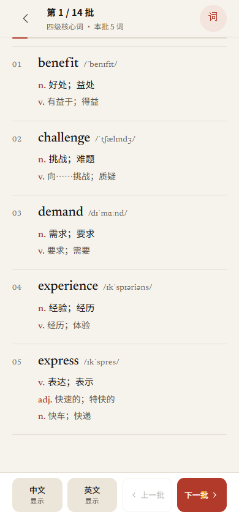
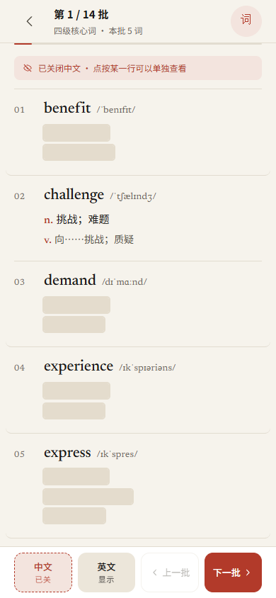
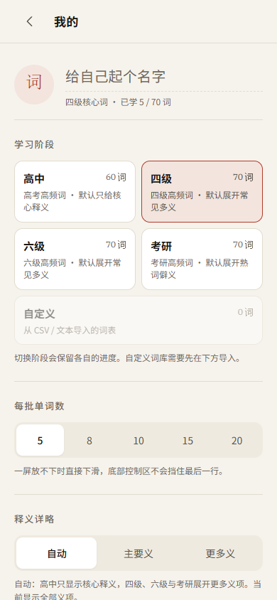

# 词笺 · 一页五个词

一个安静、专注、可以自己考自己的背单词 App。移动优先的网页应用（PWA），可安装到手机桌面、离线使用，数据只存在本机。

> 一页五个词，看一遍就会。先看，再关掉中文，最后翻过去。

| 首页 | 背单词 | 遮挡自测 | 我的 |
| --- | --- | --- | --- |
|  |  |  |  |

---

## 现在能做什么

- **一批词 = 一页纸**：默认 5 个词同屏，英文 + 音标 + 释义；可改为 8 / 10 / 15 / 20 个，一屏放不下就自然下滑。
- **释义详略自适应**：高中只看核心义，四级 / 六级 / 考研展开更多义项；也可在「我的」强制「主要义」或「更多义」。
- **遮挡自测**：底部固定「中文 / 英文」两个开关，关掉后释义或单词变成墨条；点某一行可以只偷看这一行。另有「上一批 / 下一批」翻批，位置自动保存。
- **按阶段背**：高中 3,671 词、四级 3,846 词、六级 5,406 词、考研 4,801 词（词表来自 ECDICT 1.0.28，含音标与词频），也可导入自己的词表。
- **两页结构**：背单词页 + 我的页（昵称、阶段、每批数量、释义详略、外观、词库导入、学习进度、重置）。
- **浅色 / 深色**：跟随系统或手动切换，两套都按 WCAG AA 核对过对比度。
- **离线可用**：Service Worker 缓存应用外壳，打开过之后断网也能继续背；词库和进度都在 localStorage。
- **键盘可用**：桌面端 `←` `→` 翻批，空格切换中文；所有控件可 Tab 到达。

## 快速开始

```bash
pnpm install
pnpm dev          # http://127.0.0.1:5173
pnpm build        # 类型检查 + 生产构建到 dist/
pnpm preview      # 预览生产构建
pnpm test:csv     # 词表解析的单元测试
pnpm test:books   # 内置词库的结构校验 + 种子池一致性
pnpm build:books  # 从 ECDICT 重新生成四本词库（需要先下载 ecdict.csv）
```

想在手机上看：让手机和电脑在同一 Wi-Fi，用 `pnpm dev --host 0.0.0.0` 启动，然后手机访问 `http://<电脑局域网 IP>:5173`。

> 真正的「装到桌面 + 离线」需要 HTTPS 或 localhost。部署到 Vercel / Netlify / 任意静态托管即可；`dist/` 是纯静态文件。
> 每次发新版记得把 `public/sw.js` 里的 `CACHE` 版本号加一（当前 `cijian-v2`），让旧资源从缓存里清掉。
>
> **部署到 Vercel + 安卓装成 App** 的完整步骤（含打 APK 侧载、自检命令、国内可达性风险）见 [docs/DEPLOY.md](docs/DEPLOY.md)。

## 目录结构

```
.
├─ src/
│  ├─ App.tsx                 # 状态、持久化、主题、键盘、批次调度
│  ├─ components/             # StudyScreen / WordRow / ControlDock / ProfileScreen / 导入与确认浮层
│  ├─ lib/                    # 类型、localStorage、词库与批次、CSV 解析
│  ├─ data/                   # senior / cet4 / cet6 / kaoyan 四个内置词库
│  ├─ styles/                 # tokens.css（设计变量）+ app.css（组件）
│  └─ assets/fonts/           # 自托管的 Newsreader（英文衬线，latin 子集）
├─ public/                    # manifest、Service Worker、图标
├─ docs/screenshots/          # 三档视口 / 双主题截图
├─ PRODUCT_SPEC.md            # 产品规约：信息架构、交互、数据
├─ DESIGN_TOKENS.md           # 设计系统：色彩、字号、间距、暗色映射
├─ DESIGN_REVIEW.md           # 交付前多视口审查报告
└─ scripts/                   # 词表解析测试、视口审计脚本
```

## 词表格式

内置词库（`src/data/*.json`）：

```json
{
  "lvl": "cet4",
  "label": "四级核心词",
  "source": "ECDICT 1.0.28",
  "words": [
    { "w": "abandon", "ph": "/əˈbændən/", "m": ["v. 放弃；抛弃", "n. 放任"], "r": 2182, "x": 15 }
  ]
}
```

- `m[0]` 是主要释义（带词性前缀），`m[1..]` 是更多释义。
- `r` 是词频名次（越小越常见），`x` 是考试标签位掩码（见 `src/lib/types.ts` 的 `EXAM_BITS`）。
- 内置词库是 `node scripts/build-books.ts` 从 ECDICT 的 `ecdict.csv` 生成的，**不要手改**；流程见 `docs/VOCAB_DATA.md`。
- 词库按需加载（每本一个独立 chunk），换阶段时才拉那一本；`useScheduler` 灌池前会先确保书已到齐。

导入自己的词表（「我的 → 词库 → 导入」）支持三种写法：

```
abandon, /əˈbændən/, v. 放弃；抛弃;n. 放任；纵情
benefit  /ˈbenɪfɪt/  n. 好处；v. 有益于
resilience,/rɪˈzɪliəns/,n. 韧性；恢复力
```

- 多个义项用 ASCII `;` 或 `|` 分隔；中文分号 `；` 只分隔同一个义项里的近义词。
- 表头（`word,phonetic,meaning`）、空行、`#` 注释自动跳过；解析失败会逐行报错，不静默丢弃。

## 已知限制 / 下一步

> 完整待办（按 P0–P3 排好优先级、每项带验收标准）见 [TODO.md](TODO.md)。

- **没有账号与云同步**：进度只在本机 localStorage。要「给很多人用」，下一步是账号 + 服务端同步（当前架构已把存储收口在 `src/lib/storage.ts`）。
- **内置词库来自 ECDICT**（高中 3,671 / 四级 3,846 / 六级 5,406 / 考研 4,801），释义按词性收敛到 1–2 条，默认只保证「一屏 5 词」；要全义项词典得另做详情页。
- **暂无发音**：音标是文本；接 TTS 或音频资源可作为下一步。
